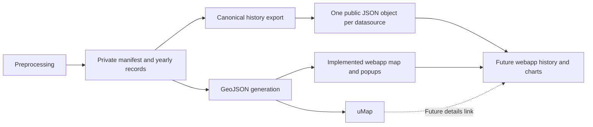

# Counter details and TraficInfo website

Updated: 2026-11-22. The webapp and canonical history export are implemented;
history charts and uMap integration remain goals.

## Current state

The static Leaflet webapp in `webapp/` provides the territory overview, selection
of city/department maps, and on-demand loading of traffic-count layers. Counter
popups show the published measurements and compact annual history. Direct map
URLs and a GitHub Pages deployment workflow are implemented.

`mapconfig.json` is the authoritative registry of maps, territory boundaries and
datasource selections. A map can combine several datasources. The webapp already
supports navigating from territory polygons to the corresponding detailed map.
See the [webapp README](../webapp/README.md) for implemented behavior and hosting.

The canonical history export is implemented by `HistoryPublicationFunction`,
invoked explicitly per datasource after preprocessing. Full-history charts and
links from uMap popups to counter details are still to be implemented. Keep uMap as a supported integration goal alongside the webapp.

## Goals

- Show a counter's complete published history in the webapp, beyond the compact
  annual-average summary currently available in map popups.
- Provide charts and exact values for available counts and other measurements,
  with source attribution and coverage information.
- Provide a direct URL identifying the datasource and counter, usable from
  both webapp navigation and a future “Plus de détails” link in uMap popups.
- Keep the website suitable for publication at `traficinfo.org`.

## Data publication

Publish **one JSON object per datasource** in the public `traficinfo` bucket.
Each object contains the complete published history in a canonical format,
independent of source-specific Java classes. Key `counters` by exact
`codeCentrale` string; each value is a counter object as defined below.

```json
{
  "schemaVersion": 1,
  "dataSourceId": "MMM",
  "sourceRevision": "manifest-revision",
  "publishedAt": "2026-11-22T12:00:00Z",
  "datasets": {
    "example-dataset": { "url": "https://example.org/traffic-counts" }
  },
  "counters": {
    "12345": {
      "codeCentrale": "12345",
      "displayName": "Example counter",
      "cityName": "Montpellier",
      "roadReference": null,
      "geometry": null,
      "osmWayId": null,
      "campaigns": []
    }
  }
}
```

The empty campaign array is abbreviated; campaign contents are defined below.
Object names are `history/MMM.json`, `history/NIM.json`, and equivalents
for other configured datasource IDs.



The model and history assembly live in the parsers module's `history` package.
A `Canonicalizer` interface has one implementation in each datasource's Java
package, registered in `GeoJsonParser.DataSource` alongside the parser and record
class. The function
module handles validated storage reads and publication through `HistoryPublisher`.

Generate this public representation from the published preprocessing manifest
and its referenced yearly objects; see the
[storage contract](datasource-storage-contract.md). Export history before the
GeoJSON age, population and count-range filters or popup-specific transformations
are applied. Records explicitly marked unusable by the publisher are classified
as `DISREGARDED` and excluded before campaign grouping and site-metadata selection.
Preserve multiple usable campaigns/channels in the same year and counters absent
from the current map.

The browser downloads the selected datasource's JSON on demand and reuses it
across counter visits. No query backend or per-counter objects are required.
Serve it as JSON, use compression and an appropriate cache lifetime, and verify
browser access from the website origin. Measure transfer size and parsing time
with actual published data. Sharding remains a future possibility if datasource
files become too large.

## Canonical counter format

The counter object holds count-agnostic identity and site metadata. All
measurement values belong inside `campaigns[].counts[]`; year, population,
direction and measured speeds are not counter-level properties.

| Counter field | Meaning |
| --- | --- |
| `codeCentrale` | String ID, identical to its key in `counters`; unique within the datasource |
| `displayName`, `cityName` | Latest known descriptive metadata, or null |
| `roadReference` | Official road reference when available, otherwise null |
| `geometry` | GeoJSON geometry in longitude/latitude order, or null |
| `osmWayId` | Associated OSM way ID as a decimal string, or null |
| `campaigns` | Array of measurement campaigns, ordered by year, period and campaign ID |

Counter metadata describes the latest known site, not its historical state in
every campaign. Retain existing site identifiers when a publisher distinguishes
locations; do not merge different sites because they used the same device.
Datasource branding and dataset URLs are shared publication metadata rather
than repeated on every counter.

### Campaigns and counts

A campaign groups measurements from the same measurement exercise and period,
including its directional and combined counts. There is usually one campaign
per year, but `year` is not a unique key: keep distinct campaigns in the same
year separate. An annual aggregate is also represented as a campaign.

Example `campaigns` array, showing a unidirectional campaign followed by a
campaign with two directional counts and their publisher-supplied combined count:

```json
[
  {
    "id": "2024-main",
    "year": 2024,
    "startDate": null,
    "endDate": null,
    "label": null,
    "datasetId": "example-dataset",
    "countingMode": "TEMPORARY",
    "counts": [
      {
        "id": "1-vehicles",
        "population": "VEHICULES",
        "directionType": "UNIDIRECTIONAL",
        "direction": { "id": "1", "label": "Towards city centre" },
        "dailyAverage": 1200,
        "dailyAverageBasis": "CAMPAIGN",
        "morningPeakAverage": 313,
        "morningPeakText": "313 (7h15 - 8h15)",
        "eveningPeakAverage": null,
        "eveningPeakText": null,
        "v85Speed": 43,
        "meanSpeed": 32,
        "coverage": null
      }
    ]
  },
  {
    "id": "2025-main",
    "year": 2025,
    "startDate": null,
    "endDate": null,
    "label": null,
    "datasetId": "example-dataset",
    "countingMode": "TEMPORARY",
    "counts": [
      {
        "id": "1-vehicles",
        "population": "VEHICULES",
        "directionType": "UNIDIRECTIONAL",
        "direction": { "id": "1", "label": "Towards city centre" },
        "dailyAverage": 1300,
        "dailyAverageBasis": "CAMPAIGN"
      },
      {
        "id": "2-vehicles",
        "population": "VEHICULES",
        "directionType": "UNIDIRECTIONAL",
        "direction": { "id": "2", "label": "Away from city centre" },
        "dailyAverage": 1100,
        "dailyAverageBasis": "CAMPAIGN"
      },
      {
        "id": "Z-vehicles",
        "population": "VEHICULES",
        "directionType": "BIDIRECTIONAL",
        "direction": null,
        "dailyAverage": 2400,
        "dailyAverageBasis": "CAMPAIGN"
      }
    ]
  }
]
```

The second campaign abbreviates optional measurement fields. The format also
supports a combined count without directional components, directional components
without a combined count, and counts whose directional coverage is unknown.

- Campaign `id` is deterministic and unique within the counter. Prefer a source
  campaign ID; otherwise derive it from available year, period and campaign
  discriminators. Never depend on input row order. Use a year-only grouping
  only when the source establishes one campaign for that counter/year. Preserve
  distinguishable campaigns; flag ambiguous grouping rather than picking a record.
- `year` is the source reporting year. Dates are nullable ISO `YYYY-MM-DD`
  measurement bounds; missing dates do not imply a full calendar year. `label`
  retains an available campaign description. `datasetId` identifies provenance
  in the publication's dataset metadata. Do not merge overlapping datasets'
  campaigns solely because their year matches.
- Campaign `countingMode` is `PERMANENT`, `TEMPORARY` or `UNKNOWN`, derived
  from explicit retained counter/campaign classifications. It belongs to the
  campaign so a site's operation can change over time. Permanent counters still
  have annual campaign aggregates; permanence does not imply complete coverage.
  MMM permanent types, departmental `Permanent`/`Per` and MRN permanent campaigns
  map to `PERMANENT`. NIM counters are always `PERMANENT`, including campaigns
  with partial coverage. Occasional/rotating/temporary types (`ponctuel`, `tournant`,
  `Tou`, `Temporaire`) map to `TEMPORARY`. Unrecognized or absent classifications,
  including the current REN model, map to `UNKNOWN`. Do not infer a
  mode from observation duration. Canonicalization also supports `DISREGARDED`
  for MMM records with `type_compteur = "ne pas tenir compte"`; these records
  never become public campaigns or contribute site metadata. Counters with no
  usable records are omitted. Conflicting modes among the remaining records in
  one identified campaign fail publication.
- Count `id` is deterministic and unique within the campaign, distinguishing
  channel and population. `population` uses `VEHICULES`, `BICYCLES`,
  `PIETONS_VELOS` or `UNKNOWN`. Preserve different populations as separate counts.
- `directionType` uses `UNIDIRECTIONAL`, `BIDIRECTIONAL` or `UNKNOWN`.
  `BIDIRECTIONAL` denotes combined coverage. `direction` is a source channel ID
  and optional label, or null when no individual direction is identified.
  Direction labels and IDs are source-defined, not inferred compass bearings.
- All numeric measurements in a count are nullable `Integer` values. Round
  nonnegative decimal source values to the nearest integer with half values
  rounded up (for example, `123.5` becomes `124`). Missing, invalid, negative or
  out-of-range values become null; preserve measured zero when distinguishable.
- `dailyAverage` is a nullable integer in passages/day. `dailyAverageBasis` is
  `ANNUAL`, `CAMPAIGN`, `OBSERVED_COMPLETE_DAYS` or `UNKNOWN`; map this from source
  semantics rather than the legacy getter name. NIM uses
  `OBSERVED_COMPLETE_DAYS`.
- `morningPeakAverage` and `eveningPeakAverage` are optional nullable integers in
  passages/hour, only when that meaning can be established from the source.
  `morningPeakText` and `eveningPeakText` preserve the available formatted source
  text, including any measurement interval and unrounded numeric representation.
  Where stored source fields separate value and hour, construct the text from
  those fields if no formatted string is available. Text remains available even
  when the numeric part cannot be parsed; absent/blank text is null.
- `v85Speed` and `meanSpeed` are optional nullable integers in km/h. Missing
  measurements stay null or omitted; a genuine zero stays zero. Do not export
  legacy sentinel values as measurements.
- Optional `coverage` holds available `firstDate`, `lastDate`, `observedDays`,
  `completeDays`, `observedHours` and `conflictingHours`, using ISO dates and
  integer counts. It describes the individual count's observations, not an
  assumed full-year sampling period. The export contains only canonical fields;
  source-specific supplementary values are not published.

Retain supplied combined counts without adding them to directional counts.
Do not synthesize missing combined averages or speeds in this export. OSM speed
limits and bicycle contraflow are contextual road information, not campaign
measurements; any future inclusion must identify them as current context.
This public history format does not change the existing private yearly storage
contract. See the [export usage and normalization limits](../dsfunctions/README.md#canonical-counter-history-export).

The export includes a `datasets` map keyed by dataset ID, with each value
containing its attribution `url`. Campaigns use year and dataset identity, plus
MRN campaign type/details where available. Exact canonical duplicates collapse;
conflicting counts sharing a campaign/channel/population fail publication.
Counter metadata uses the latest known nonblank value per field, with
deterministic tie-breaking within a reporting period.

## Counter identity and charts

Identify a counter by datasource ID plus `codeCentrale` (`code_centrale` in
GeoJSON). Preserve IDs as strings, including leading zeros and site suffixes.
Keep population, direction and campaign distinctions when displaying records;
do not sum bidirectional totals with their component directions.

Use annual bar charts for the history already retained. Show missing years as
gaps, preserve missing values versus measured zero, and distinguish observed
campaign averages from full-year measurements. Display speed and peak-hour
history only where comparable data exists, with exact values available in a table.

Daily/hourly charts require corresponding retained observations or aggregates.
For example, NIM currently stores site/year aggregates, which cannot reconstruct
hourly history. Mean speed and V85 likewise cannot reconstruct speed distributions.

## Future uMap integration

Add a “Plus de détails” link to both vehicle and bicycle popup templates, opening
the counter details in the existing webapp. Generate a URL-encoded `details_url`
GeoJSON property containing the datasource, counter ID and relevant population.
Choose the counter route within the existing webapp navigation when implementing
it; the earlier standalone `counter.html` proposal is not a required route.

Update the shared map template, bicycle-layer template and parser popup resource,
and regenerate affected map templates. Verify links in an actual uMap instance.
An iframe using the same details view can be considered later; standalone
navigation is the initial goal.

## Remaining work

1. Deploy and invoke the implemented export for the desired datasources.
2. Add on-demand history loading, charts and direct counter navigation to the
   implemented webapp.
3. Add and verify uMap popup links to that view.

Check sparse histories, multiple records per year, populations/directions,
missing values, unknown counter IDs and unavailable data. Confirm that details
include published years beyond the compact popup history and map display filters.
