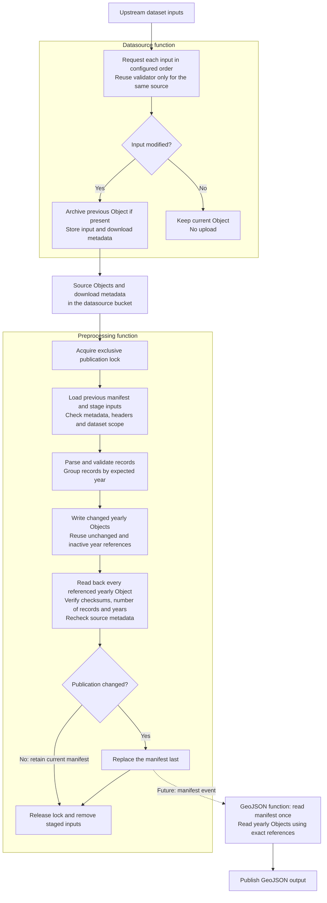

# Shared datasource storage contract, version 1

This contract applies to all datasource IDs in `dsconfig.json`. It defines source retrieval, yearly preprocessing and manifest publication.
GeoJSON consumption of the manifest remains a separate step.

Data is stored in Object Storage, with one bucket per data source. In this
specification, Object refers to an item stored in that bucket.

A datasource such as NIM or DPT34 can contain multiple datasets. Each dataset
has a `datasetId`, such as `nim-2022` or `nim-2023-2024`; one dataset is actively
monitored at a time. Datasource branding uses the top-level `dataSourceLogoUrl`
and optional `dataSourceFaviconUrl`; the dataset page URL is
`source.datasetInfoUrl`, next to `source.datasetId`.

## Objects

Object names are relative to the datasource's configured input bucket. Use the
configured datasource ID, including MMM despite its legacy bucket/function names.

| Object | Contents |
| --- | --- |
| `<datasourceId>_Manifest.json` | Current complete publication |
| `<datasourceId>_Preprocessing.lock` | Exclusive publication lock |
| `data/<revision>/<datasourceId>_Comptage_<year>.json` | Yearly array of Comptage records |

Revisions are unique path components. Published yearly Objects are immutable:
a later run writes a new path instead of overwriting an Object referenced by the
current manifest. Unchanged years retain their existing paths. Only the current
manifest is replaced.

JSON uses UTF-8 without a BOM. Checksums are SHA-256, represented as 64 lowercase
hexadecimal characters, over the exact uncompressed payload bytes (including
whitespace). Optional `Content-Encoding: gzip` does not change these checksums.
Publication timestamps are ISO 8601 UTC strings ending in `Z`.

## Manifest (`DataManifest`)

- `manifestVersion`: manifest format version, currently 1.
- `dataSourceId`, `revision`, `publishedAt`: publication identity.
- `activeDatasetId`: the dataset currently monitored.
- `datasets`: upstream datasets, retained after monitoring switches.
- `years`: exact Object references, checksums, record counts and source/parser
  information for every year available to GeoJSON generation.

Each dataset has a `datasetUrl`, explicit `years` scope and named `inputs`.
An input has a retrieval `url`, `format` (CSV or GEOJSON in the examples), and
`headers`: the ordered parsed CSV column names, or null for non-CSV input.
MMM can therefore have counts and companion geometry within one dataset.
Headers live directly in the manifest; no separate headers Object is needed.

Each year entry has `object`, `sha256`, `recordCount`, `datasetId` and
`parserVersion`. For example, NIM's 2022 Object can remain at
`data/r0001/NIM_Comptage_2022.json` while 2023 and 2024 refer to `data/r0002/`.
Switching the active dataset never removes years from inactive datasets.

## Yearly arrays

Each yearly Object contains an array of Comptage records for its named year.
`ComptageJson` serializes the existing source-specific implementations by stored
field name, including null values. Derived getter aliases such as NIM's
`moyenneJourAnnuelle` are excluded, preserving the distinction between a null
`dailyAverage` and zero. MMM records include geometry from the companion input.
There is no additional count model or separate retrieval provenance Object.

Properties and array records use deterministic ordering. Header order is retained
in the manifest; reordering data rows alone does not change yearly checksums.
The datasource ID selects the concrete count class when reading. `parserVersion`
is maintained in code and must change when the stored interpretation changes.

## Source retrieval configuration

The datasource function downloads the active source inputs into its bucket. It
neither reads nor writes the manifest. Deployment reads the datasource's `source`
entry in `dsconfig.json` and passes `dataSourceId`, `datasetId` and ordered
`inputs` through the `DATA_SOURCE_SETTINGS` function configuration. The function
reads these settings through `RuntimeContext`; it does not read the repository
file at runtime.

Function configuration carries only active retrieval settings; CSV headers and
manifest history remain in Object Storage. Deployment enforces OCI's 4096-byte
UTF-8 key/value budget, including inherited application settings, before changing
any function. Function-level values override application values with the same key.

Each input specifies `url`, `contentType` and an optional `objectName`. CSV names
default to `<datasourceId>_Comptage.csv` (or the configured `csvObject` override).
Companion inputs specify their Object names explicitly. Inputs are published in
list order, so MMM's geometry JSON precedes its counts CSV. Source Objects retain
the existing names and archive convention. A failure stops later inputs; this
stage does not create an atomic snapshot of multiple inputs.

Successful retrieval stores the datasource ID, dataset ID, source URL and UTC
download time in Object metadata. Conditional downloads reuse validators only
for the same source URL, dataset and datasource. Older Objects without these
fields are refreshed once. Switching datasets therefore cannot reuse the old
dataset's validator. All datasource handlers require `DATA_SOURCE_SETTINGS`
and `BUCKETNAME`; missing settings fail before any clients are created. Retrieval
URLs and dataset IDs are configured only in `dsconfig.json`, with no Java
fallbacks. Each handler supplies only its datasource ID to the shared retrieval
superclass. `CsvDataSource` retains only GeoJSON parser selection and naming.

The optional `source.timeoutSeconds` sets the download function's synchronous
runtime timeout (1–300 seconds). Deployment applies it on creation and updates;
invocation allows an additional 60 seconds when it exceeds the default 30. NIM
uses 300 seconds for its 2022 export. `geoJsonEnabled: false` marks a datasource
as having no GeoJSON handler: event setup skips it and GeoJSON
invocation/deployment is disabled. Explicit preprocessing is independent of this flag. Other sources remain enabled by default.

## Processing sequence

1. **Datasource function:** retrieve the configured inputs and store them as
   Objects in the datasource bucket.
2. **Preprocessing function:** read the source Objects and check CSV
   headers against the manifest for the same dataset/input. Preprocessing permits
   column additions and reordering, but rejects blank or
   duplicate headers and removal/renaming of any previously recorded column.
   Added columns are logged at warning level with datasource ID, dataset ID,
   input Object name and new column names. First publications have no previous
   headers to compare. Extra columns are ignored by the current source parsers.
   A new dataset gets its own headers after successful parsing. On the first
   run, check the parser's required columns because no manifest exists yet.
3. Parse and validate, then write yearly Objects under a new revision. Missing
   inputs must fail validation rather than erase published data. Years outside
   the configured scope are skipped and logged as a distinct set at INFO level.
   Configured years without records are also logged at INFO level; their existing
   yearly Objects remain referenced. Only years within the dataset's scope change.
4. Verify the complete referenced Object set, then publish the manifest last.
5. **GeoJSON function (later):** trigger from that manifest. Read it once and
   follow its exact Object references instead of listing Objects by wildcard.

## Workflow diagram

The diagram shows data flow; preprocessing is currently invoked manually.
The dashed connection is the future manifest-triggered GeoJSON workflow.
The datasource decision applies to each input independently; both outcomes
continue with the next configured input. An unchanged response causes no upload
or Object event. Preprocessing can also be invoked manually on existing Objects.



A preprocessing error stops publication and releases the acquired lock during
normal cleanup. The previous manifest is retained; yearly Objects written before
the failure can remain unreferenced. A terminated invocation can leave a lock,
as described below.

## Preprocessing configuration and execution

Deployment builds `PREPROCESSING_SETTINGS` from the existing retrieval settings,
`source.datasetInfoUrl`, and `preprocessing.years` in `dsconfig.json`:

```json
{
  "source": {
    "dataSourceId": "NIM",
    "datasetId": "nim-2022",
    "inputs": [{
      "url": "https://example.org/counts.csv",
      "objectName": "NIM_Comptage.csv",
      "contentType": "text/csv"
    }]
  },
  "datasetUrl": "https://example.org/dataset",
  "years": [2022]
}
```

The shared `PreprocessingFunction` supports all current datasource IDs. NIM has
an initial explicit scope of `[2022]`; other sources require their own expected
years before invoking this stage. The scope may expand. Reducing the scope or changing input Object names for
an existing dataset requires a new `datasetId`. Records outside the configured
scope are skipped, with their distinct years logged at INFO level. Configured
years with no records are also logged as a set at INFO level and do not prevent
publication. Such years retain their previous Object references, if any; no empty
yearly Objects are written. A first publication with no in-scope records can have
an empty manifest `years` map, while the dataset retains its configured scope.
NIM's established hourly aggregation, 1970 exclusion and conflicting-hour policy
apply. Other sources retain their existing parser's annual/campaign semantics.
No OSM enrichment or GeoJSON filtering occurs during preprocessing.

All inputs must carry matching downloader metadata (datasource ID, dataset ID,
source URL and download time). Legacy inputs must be refreshed by the datasource
function first. Inputs are staged locally and their metadata is checked again
before publication; a concurrent replacement aborts publication. This detects
changes during a run, but does not turn multi-input retrieval into an atomic
upstream snapshot.

Publication is serialized per datasource using atomic create-if-absent of the
lock Object. There are no ETag-based updates. Normal completion or failure
releases the lock. A terminated invocation can leave a lock: inspect its owner
and UTC start time, confirm no publisher is running, then remove it manually.
Locks never expire automatically, avoiding races with slow invocations.

Each changed year is written under a fresh UUID revision, using create-if-absent.
Unchanged years retain their paths. The function reads back every referenced
yearly Object, including inactive datasets' years, checking checksum, record
count and year before replacing the manifest last. Identical retries leave the
manifest unchanged. A failed run leaves the previous manifest usable and may
leave unreferenced yearly Objects; automatic cleanup is outside this step.

Preprocessing deployment and invocation are explicit (`preprocess` in the shared
scripts), with a 300-second runtime timeout. It is not included in a deployment
without arguments, has no schedule tag and is not connected to Events yet.
GeoJSON handlers continue using their current inputs until their separate
manifest migration.

## Compatibility and examples

Missing or unsupported manifest versions are rejected. The model uses Jackson's
default strict handling of unknown fields and the existing Jackson dependency.

JSON examples live in `parsers/src/test/resources/storage`. The NIM manifest
shows a dataset switch preserving 2022; the MMM example shows companion inputs.
URLs, headers, record counts and checksums are illustrative. Tests retrieve no
remote data and do not verify these example checksums against actual Objects.
