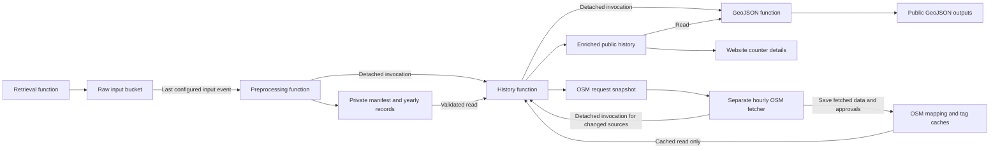

# Detached processing workflow

Status: proposed; no implementation or deployment is included.
Created: 2026-11-23. Updated: 2026-11-26.

## Objective

Make canonical counter history the shared, enriched representation consumed by
the website and GeoJSON generation. Chain processing stages through explicit
detached OCI Functions invocations, retaining the raw-input bucket event as the
entry point to preprocessing. Keep remote OSM fetching in its existing separate
function, including its hourly schedule, lookup budgets and review workflow.

Keep cloud-specific storage, invocation and event handling behind narrow
application-owned boundaries so a future AWS implementation can reuse the
processing logic. OCI remains the sole implementation and deployment target;
this proposal does not introduce AWS adapters or a cloud migration.

This document specifies workflow behavior only. Count representation, canonical
metadata, public data fields and map-output differences are owned by the separate
[data canonicalization and representation specification](data-canonicalization-and-representation.md).
This specification remains focused on general workflow.

Existing documentation describes
the implemented pipeline until this proposal is implemented. Related contracts:

- [Private preprocessing storage](datasource-storage-contract.md).
- [Canonical history and website](counter-details-and-website.md).
- [OSM fetching, caches and reviews](osm-data.md).
- [GeoJSON properties](geojson-feature-properties.md).
- [Function usage](../dsfunctions/README.md).

## Current and proposed flows

Currently, retrieval writes raw inputs, a bucket event invokes preprocessing,
and a manifest event invokes GeoJSON. History publication is manual. GeoJSON
reads private yearly records, applies cached OSM enrichment and publishes OSM
requests independently of history.

The target flow is:



Only the raw-input event remains a bucket-triggered processing handoff. No
manifest, public-history, OSM-request or OSM-cache object event starts another
stage. Retrieval does not invoke preprocessing directly.

## Cloud integration boundaries

Stage orchestration and processing depend on application-owned storage and
invocation contracts and normalized requests. OCI entry points construct the
concrete adapters and inject them into the stage services. Source parsing,
canonicalization, cached enrichment, OSM change selection and GeoJSON rendering
must not inspect OCI SDK types, OCIDs, invocation endpoints or event envelopes.

Scope this separation to the pipeline components touched by this change. Reuse
or adapt existing storage and publisher abstractions; do not create parallel
storage stacks or refactor unrelated functions solely for possible portability.
The contracts below describe responsibilities, not mandatory Java type names
or a new framework. Use plain application types and standard Java streams,
paths and values at their boundaries.

### Object storage

Processing services use the application-owned
[`ObjectStore`](../dsfunctions/src/main/java/org/traficinfo/dsfunctions/ObjectStore.java)
interface and [`ObjectMetadata`](../dsfunctions/src/main/java/org/traficinfo/dsfunctions/ObjectMetadata.java)
values. Their JavaDoc defines the storage API contract. The OCI adapter owns
addressing, authentication and provider request/response translation.

Keep this boundary limited to the existing lifecycle; storage preservation
checks are listed in the [acceptance criteria](#acceptance-criteria-for-future-implementation).

### Stage invocation

Stage services depend on an application-owned invoker taking a logical stage and
request. Only the OCI adapter reads deployment-specific target settings and
constructs SDK requests. The [invocation contract](#invocation-contract) defines
its complete delivery, acknowledgement, payload and timeout behavior.

### Event and runtime entry points

Keep cloud entry points thin: receive provider input, normalize it, establish
runtime/logging context, then call the application service. Preserve the existing
outer function failure-reporting behavior in the OCI entry point. Keep runtime
configuration, resource-principal construction and client lifecycle there or
in the adapter construction layer, outside parsing and rendering logic.

The OCI event adapter owns JSON envelope decoding, OCI event-type names,
namespace checks and translation of bucket/object identity. Resolve the last
configured raw-input identity through the datasource registry and pass a normal
preprocessing request containing `datasourceId` to the service. Manual requests
use the same normalized request, with optional `datasetId` for archive imports.
Provider-specific event identifiers remain diagnostic context, not datasource
identity or processing checkpoints.

Public history and GeoJSON services receive datasource requests, not cloud
events. A future event adapter may translate a different envelope or a batch of
notifications into individual normalized requests without changing those services.
This does not introduce new OCI batch handling, routing/ordering defenses,
deduplication or overlap control. Keep current event-validation behavior.

### Future provider replacement

A later AWS move would replace the storage adapter, asynchronous invocation
adapter, event/runtime entry points, IAM configuration and deployment scripts.
The intended reusable core includes datasource selection, parsing, publication
ordering, canonical history, cached enrichment, request collection, OSM change
decisions and map rendering. External publisher and OSM HTTP calls are not OCI
integrations and remain separate from these cloud adapters.

This separation does not promise a configuration-only migration or equivalent
quotas, event delivery or execution budgets. Keep the current long-running OSM
schedule and budgets on OCI; assess their fit with a future execution service
at migration time. Do not add AWS dependencies, runtime provider selection,
dual-cloud deployment, data copying or backward-compatible formats now.

## Invocation contract

This section is the single definition of invocation semantics. All new
function-to-function calls use the application-owned contract, conceptually
`invokeAsync(stage, request)`, with logical stage `history` or `geojson`. Its OCI
adapter resolves the stage to deployment-supplied function OCIDs/endpoints and
uses the OCI SDK with invocation type `Detached`, authenticated through the
caller's resource principal. Processing services do not construct SDK requests
or read target settings. Send the existing minimal selection payload:

```json
{"datasourceId":"DPT34"}
```

The receiver resolves storage and datasource settings from its own configuration.
Do not send records, object bodies, bucket overrides or a caller-selected private
manifest revision. Each invocation reads the current published input when it
starts. Skipping intermediate snapshots is acceptable.

The caller waits for the invocation API response before returning. It must not
launch an unawaited background task. A successful HTTP 202 response establishes
the detached handoff; it does not establish downstream publication success.
Return an acknowledgement, optionally retaining an opaque provider request ID,
or throw a normalized invocation failure. Processing failures are reported as
specified in [failure handling](#failure-consistency-and-manual-operation).

Manual invocations remain synchronous so the existing invocation script can
inspect the response body and return failure when `success` is false, even if
OCI reports invocation success. Their downstream handoffs use the same detached
contract. A manual stage success covers that stage and its required handoff,
not completion of the whole chain.

Do not hide retries or claim identical delivery semantics across providers.
Any future adapter must document and explicitly configure its provider's
acceptance, retry, duplicate-delivery, concurrency and execution-time behavior
before adoption. No additional recovery mechanism is introduced here.

Configure detached execution timeouts explicitly: initially 300 seconds for
history and GeoJSON. Preserve the OSM fetcher's existing longer scheduled budget.
The invocation client's response timeout is separate from downstream execution
time. No caller waits for the whole chain to complete.

These semantics follow Oracle's [invocation documentation](https://docs.oracle.com/en-us/iaas/Content/Functions/Tasks/functionsinvokingfunctions.htm)
and [timeout settings](https://docs.oracle.com/en-us/iaas/Content/Functions/Tasks/functionscustomizing.htm).

## Publication and handoff ordering

This table is the single definition of publication sequencing and downstream
handoff conditions. All handoffs use the [invocation contract](#invocation-contract).
For preprocessing and history, a failed required step stops the downstream
handoff; already published objects remain in place. The OSM row explicitly
allows handoffs for saved partial progress and applies independently per source.

| Stage | Required sequence and handoff condition |
| --- | --- |
| Retrieval | Preserve configured input order. For each changed existing input, finish reading/writing its archive before replacing the current object. The last configured input's bucket event starts preprocessing; retrieval has no explicit downstream call. Unchanged inputs are not uploaded. |
| Preprocessing | Preserve validation and immutable yearly-object publication, then publish the manifest last. Leave the manifest untouched for unchanged output. Every successful invocation, including unchanged results, manual requests and archive imports, hands off to history. |
| History | Validate inputs, assemble/enrich history, and prepare/validate/serialize history and its request snapshot before replacing public history. Publish `history/<datasourceId>.json`, then `<datasourceId>_OSMRequests.json`. After both succeed, hand off to enabled GeoJSON, including when effective data is unchanged. |
| GeoJSON | Validate the current history input, then publish the existing vehicle and bicycle outputs sequentially. Preserve empty-output publication. There is no downstream handoff. |
| OSM fetcher | One OSM run may invoke history for several datasources, but at most once per affected datasource. Finish each source's cache-write attempts first and combine its qualifying persisted changes into that single handoff. Include saved progress even if another update failed. History publication follows the history row; no retrieval or preprocessing run is required. |

## Stage responsibilities

### Retrieval and preprocessing

Preserve retrieval validators and preprocessing validation, inactive-year
retention and unchanged-output detection. Publication and trigger behavior follows
the [ordering contract](#publication-and-handoff-ordering).

The unconditional handoff after successful preprocessing makes manual execution
a way to regenerate derived publications without a force flag. Duplicate input
events can cause repeated work; that is acceptable.

### History publication

History reads the private manifest and all referenced yearly records, assembles
the enriched canonical representation and prepares the datasource-owned OSM
request snapshot. Canonical assembly, metadata selection and enrichment fields
follow the [data-model specification](data-canonicalization-and-representation.md).
Publication and downstream handoff follow the
[ordering contract](#publication-and-handoff-ordering).

History loads caches once per invocation. It never calls Nominatim or the OSM
way API and never writes mapping or tag caches. Missing caches mean enrichment
is unavailable; malformed caches and storage errors other than missing objects
fail the invocation. Stale cached tags remain usable and generate refresh
requests under the existing freshness policy. Clearing satisfied requests must
not stop future expiry checks: ongoing cache freshness belongs to the hourly
OSM fetcher, independently of history or traffic-input changes.

Keep existing gzip upload and five-minute history cache behavior. History
publication remains a full replacement with a fresh `publishedAt` on each
successful run; content-based suppression is not required.

### GeoJSON publication

GeoJSON reads `history/<datasourceId>.json` directly through Object Storage,
without a public HTTP/CDN cache, and validates the supported schema, datasource
identity and fields required for rendering before publishing outputs.

It no longer reads private preprocessing manifests/yearly objects, deserializes
source-specific `Comptage` subclasses, loads OSM caches, publishes OSM requests
or calls OSM APIs. It projects canonical campaigns/counts into map features.

Preserve output object names and compression; use the
[ordering contract](#publication-and-handoff-ordering) for publication behavior.
Data validation, count selection and map
representation follow the [data-model specification](data-canonicalization-and-representation.md#geojson-projection),
including its measurement-metric definitions. They are not redefined here.

### OSM request publication

Collect requests for all retained usable counters, including counters absent
from the current map. Only supported point coordinates can drive reverse
lookups; do not invent a representative point for other geometries. Request
missing/stale tags for effective known ways. Publish a complete request snapshot,
including empty sections, to clear obsolete requests. This broadens OSM demand
beyond the present map-filtered population; retain bounded fetching and its
existing fairness allocation rather than making history wait for enrichment.
The request snapshot describes currently outstanding work, not the complete
inventory of ways that the OSM fetcher must check for future expiry.

The data-model specification defines which canonical metadata supplies lookup
context; the fetcher retains its existing mapping acceptance/review rules.

### Publication provenance

OSM-only republication keeps the private manifest's `sourceRevision` unchanged
and updates `publishedAt`. The manifest revision alone does not identify an
enriched publication. Field definitions and schema versioning belong to the
[data-model specification](data-canonicalization-and-representation.md#enriched-history-contract).
Backward compatibility is not required for this change, as recorded in the
implementation plan below.

## Refreshing publications after OSM updates

The OSM fetcher remains the sole writer of mapping/tag caches. It retains hourly
and manual invocation, bounded remote calls, review exports and approval input
handling, including accident-source caches.

### Detecting expired traffic-source tags

On every hourly run, the OSM fetcher independently evaluates cached traffic-source
way tags against the existing freshness policy, even when the source's request
snapshot is empty or absent and its traffic inputs have not changed. Preserve
the current three-calendar-month expiry calculation and handling of missing or
invalid cache timestamps.

For each traffic source, consider all way IDs already in its tag cache and all
accepted positive way IDs in its counter-mapping cache. Merge this inventory
with explicit tag requests and ways resolved during the run. Queue missing or
expired tags, deduplicating by way ID within the source; fresh tags need no
remote call. Source discovery must include traffic sources with only a tag cache,
without requiring a mapping-cache object or outstanding request snapshot.

Use the existing lookup/time budgets and source-allocation behavior. Within a
source, reshuffle all eligible way IDs on each run before taking the bounded
batch. Do not enforce strict missing-first or oldest-first priority: a fixed
set of failing entries must not always consume the budget ahead of other work.
This provides selection opportunities across repeated runs without a persistent
cursor, checkpoint or retry queue. Work skipped by the budget remains eligible
at the next scheduled run. A failed fetch preserves the previous tags and
timestamp and remains eligible; do not add immediate retries or mark failed
work fresh.

The chosen refresh population is all cached traffic-source ways, including ways
no longer referenced by current retained history. This avoids reading public
history or adding a persistent reference inventory to the fetcher. Empty history
requests do not delete cache entries or retire them from expiry checks. Cache
pruning and limiting refresh to currently referenced ways are outside this change.
Accident-source processing retains its existing lifecycle and does not enter the
traffic history chain.

These checks use existing caches and the existing hourly schedule. They require
no new scheduler, checkpoint, completion marker or request format. Manual OSM
runs use the same eligibility rules within their existing shorter budgets.

### Republishing changed enrichment

During each run, track which traffic datasources acquire a persisted change to
their effective enrichment inputs. Compare before/after cache values relevant
to publication, as defined by the data-model contract: accepted counter-to-way
assignments and enrichment values derived from cached tags. Include additions, changed values and
removals. Changes only to lookup timestamps, last-seen fields, review text or
other unused tags do not require republication. Newly available enrichment
information also counts as a change under the data-model contract.

This comparison is local to the current run, not a durable processed-revision
checkpoint. Capture changes across the full run, including approved mappings
saved before the remote lookup loop for sources later skipped by its time budget.
Eligible targets are configured traffic datasources supporting canonical history.
Accident prefixes such as `ONISR_DPT30` retain their current lifecycle.

Apply the OSM row of the [ordering contract](#publication-and-handoff-ordering).
Reserve time outside the remote-lookup budget for the bounded invocation API
calls.

If another source fails, still attempt handoffs for successfully saved changes.
If a source saves a new mapping but fails while updating tags, its persisted
mapping change can still trigger history using the available caches. Do not use
unsaved in-memory tags as evidence that public enrichment can be refreshed.
Accumulate and report failures after attempting the remaining eligible handoffs,
preserving existing review-submission safety behavior.

The independent expiry check continues after satisfied requests are cleared.
An identical tag refresh saves the new freshness timestamp without republication;
a qualifying enrichment change follows the ordering contract.

There is no immediate invocation loop: history writes requests but cannot invoke
the OSM fetcher. Remaining requests wait for its next scheduled or manual run.

## Failure, consistency and manual operation

Publication and detached handoff are separate operations. No atomic transaction
spans storage objects, functions or the two GeoJSON outputs. Consumers can
temporarily see different generations; an invocation uses whichever current
publication it reads when it starts. Detached execution does not guarantee
completion order across separate invocations.

Preserve the existing distinction between application processing failures and
OCI execution failures. The outer boundary normally reports an application
failure through the `FunctionFailures` metric and logs, then returns a
`success: false` error body. OCI may therefore record a successful execution
despite failed processing. Application failure metrics/logs are authoritative
for those failures; OCI execution status alone is insufficient. Preserve the
existing rethrow behavior when failure reporting itself fails. In the table
below, "report failure" means this application-level behavior unless an OCI
execution failure occurs independently.

| Failure | Required result |
| --- | --- |
| Preprocessing validation/publication fails | Preserve existing publication behavior and report failure. |
| History validation or serialization fails | Leave existing public history in place and report failure. |
| History upload succeeds but request upload fails | Report failure; history may already be newer than requests/maps. |
| A detached invocation API call fails | Report failure in the caller; retain already published objects. |
| A downstream execution fails after HTTP 202 | Report failure in that downstream stage; the completed caller does not become unsuccessful retroactively. |
| One OSM source or handoff fails | Continue eligible handoffs for other saved changes, then report the run's failures. |
| One GeoJSON output upload fails | Preserve existing partial-publication behavior; report GeoJSON failure. |

Do not add immediate retries, a queue/outbox, completion markers, reconciliation
schedules, new locks, overlap control or lost-event recovery as part of this
change. An ambiguous invocation response can mean the receiver started; manual
reruns may duplicate work. Repeated parsing and publication are acceptable.

Keep explicit datasource invocations for preprocessing, history and GeoJSON,
using the manual mode defined in the [invocation contract](#invocation-contract).
An operator can rerun history to regenerate both public history and maps, or
rerun only GeoJSON from current public history. Retain source selection and
archive-import controls in preprocessing.

If an OSM-triggered handoff fails, the next hourly run is not guaranteed to
retry it: caches may already contain the change and no new effective difference
may occur. Likewise, unchanged retrieval does not repair downstream failures.
Manual history invocation is the recovery path in scope; automatic recovery is
an explicit limitation of this design.

## Configuration, permissions and observability

OCI deployment resolves the history and GeoJSON function IDs and invocation
endpoints and supplies them to the callers' invocation adapters. Suggested
OCI adapter settings are
`HISTORY_FUNCTION_ID`, `HISTORY_INVOKE_ENDPOINT`, `GEOJSON_FUNCTION_ID` and
`GEOJSON_INVOKE_ENDPOINT`, set only on functions that need the relevant target.
Do not perform resource discovery on every invocation. Function IDs are deployment
settings, not datasource input-bucket overrides. These settings and OCI SDK
credentials must not leak into application service contracts or public artifacts.

Keep datasource IDs, input buckets, GeoJSON enablement and naming exceptions in
`dsconfig.json`. Use existing shared setup values in scripts. The shared
application name can remain `3MOpenDataProcessor`. Deployments must resolve
callee resources before configuring callers; no new per-source application
field is required.

Grant callers permission to invoke only the required target functions using the
existing resource-principal model and the narrowest supported application scope.
History gains OSM-cache read and request-object write access. GeoJSON needs
history read and output write access, with no OSM access or private yearly-input
dependency. Retain preprocessing and OSM-fetcher storage permissions.

The target event configuration includes raw-input-to-preprocessing rules only;
manifest-to-GeoJSON rules must not remain active alongside explicit chaining.
Changing existing deployments or retiring existing rules is future implementation
work, not an action authorized by this specification.

Use existing structured stage/datasource logs. Log target stage, datasource,
handoff success/failure and invocation request identifiers when provided by OCI.
Distinguish publication completion from downstream handoff. OSM logs must identify
which sources required republication and why. Do not log record bodies or
credentials. Keep existing failure reporting and update monitoring documentation
for any revised metric definitions.

## Implementation plan

Implement in small, independently reviewable changes. Each change must compile
and pass its relevant checks, but intermediate commits do not all need to be
deployable. This plan authorizes no implementation or cloud changes by itself.

No maintenance window or backward compatibility is required. Apply agreed schema
changes directly, without old-format fallback readers, dual publication or
temporary compatibility modes. Representation details remain in the separate
data-model specification. Temporary processing failures or mixed publication
generations during deployment are acceptable under this plan.

| Step | Increment | Validation before proceeding |
| --- | --- | --- |
| 1 | Separate reading and writing stored files from the processing logic. Keep using OCI and preserve how files are read, saved, archived and protected from conflicting writes. | Check that storage, retrieval, preprocessing and OSM still work as before, including creating a file only if it does not already exist, locking and archiving. |
| 2 | Separate OCI event decoding/runtime setup from stage processing. Pass normalized requests into processing services. | Event, manual and archive-request handling; existing failure reporting; service tests without OCI runtime objects. |
| 3 | Add the logical stage invoker and OCI detached adapter, including target configuration and normalized failures. Leave production handoffs unwired. | Target selection, minimal payload, detached request construction, acknowledgement and invocation failures using SDK test doubles. |
| 4 | Add independent OSM expiry discovery, fair bounded tag selection and tracking of qualifying persisted changes. Leave the history handoff unwired. | Empty/absent requests, tag-cache-only sources, expired/missing tags, failed fetches, shuffled selection and timestamp-only changes. |
| 5 | Prepare the agreed canonical-history model changes and a GeoJSON renderer consuming history, following the data-model specification without redefining its rules here. | Representative fixtures across datasources, public output contracts and website history consumption; identify expected representation differences. |
| 6 | Move cached enrichment and traffic-source OSM request production into history publication. Keep remote OSM fetching separate. | Cache read behavior, serialization/publication failures and the history row of the ordering contract; no remote OSM calls or cache writes from history. |
| 7 | Switch GeoJSON publication to history input and connect the processing handoffs through the invoker. Remove GeoJSON's preprocessing/OSM dependencies and traffic-request writes. | End-to-end service checks for all rows of the ordering contract, including unchanged preprocessing, archive imports, partial OSM progress and disabled GeoJSON. |
| 8 | Update OCI permissions, target settings, timeouts and deployment/event scripts for the new chain. Preserve synchronous manual invocation. | Script tests and dry-run output for target resolution, configuration, permissions and retirement of old manifest triggers. |
| 9 | Deploy downstream first, verify the running chain and update usage/operational documentation. | Representative input-driven and OSM-only runs, unchanged-input behavior, application failure reporting and manual recovery. |

Steps 1–3 preserve processing behavior; step 4 can operate with the current
pipeline. Steps 5–7 can be separate commits but should be released as one
completed set rather than supporting partially converted production formats.
The renderer and enriched-history work both depend on the agreed data-model
contract; step 7 also depends on the invocation adapter and OSM change tracking.
Run the affected module and script checks for each increment; include website
checks when the public history contract changes. Complete the workflow acceptance
checks before deployment rather than repeatedly running unrelated suites.

### Deployment sequence

Use the completed code/configuration set from steps 1–8. Do not pause schedules
or introduce a compatibility deployment phase:

1. Resolve target function resources and establish the required invocation/storage
   permissions and settings before activating their callers.
2. Deploy the GeoJSON consumer that reads canonical history.
3. Retire manifest-to-GeoJSON event rules before activating explicit downstream
   chaining, then deploy history publication with its GeoJSON handoff. History
   becomes the sole traffic-source OSM request producer.
4. Deploy preprocessing and OSM callers, and reconcile the retained raw-input
   event rules. Keep scheduled retrieval and OSM fetching in operation.
5. Manually invoke history for selected validation sources and inspect the
   resulting GeoJSON. Verify the raw-input path and an OSM-only refresh using
   actual qualifying changes, then check the remaining configured sources.

Earlier intermediate deployments may encounter missing or outdated inputs;
there is no requirement to read both old and new formats. Use explicit stage
invocation for recovery as described in the failure section. Do not add an
automatic backfill or deployment-reconciliation mechanism.

### Decisions before the affected steps

- Before step 5, settle the public schema/version and remaining representation
  choices in the data-model discussion. Compatibility handling is already
  excluded; it is not an approval gate for foundational steps.
- Before step 8, choose invocation API timeouts and the OSM handoff time allowance
  within the existing execution budget.
- Before step 9, select representative validation sources. No maintenance-window
  decision is needed.
- Before scaling to 100 datasources, choose grouped raw-input event rules or an
  appropriate rule-limit increase. This need not block initial implementation.

## Acceptance criteria for future implementation

- Processing services depend on application-owned storage and asynchronous
  invocation contracts and normalized requests. OCI SDK/runtime types, function
  IDs, namespaces and event envelopes are confined to adapters and entry points.
- Verify the existing storage operations against their JavaDoc contracts:

  | Operation | Acceptance check |
  | --- | --- |
  | Read body | Raw inputs, manifests, yearly records, history and OSM objects remain readable. Missing bodies throw `ObjectNotFoundException`; other request failures throw `StorageException` with the provider cause and available request ID. |
  | Inspect custom metadata | Retrieval validators and preprocessing validation/existence checks retain their behavior. An existing object without custom metadata returns empty metadata; only an absent object returns null. |
  | Write/replace | Raw inputs, archives, manifests, public outputs and OSM objects retain their keys, media types, custom metadata and configured cache control. |
  | Create only when absent | Immutable yearly objects and preprocessing locks are created atomically. An existing key returns false without replacement; other failures propagate. Preserve the current lock acquisition/release lifecycle. |
  | List names | OSM discovery sees all object names across all listing pages, including empty listings. |
  | Delete | Existing preprocessing lock release and processed OSM approval-submission deletion retain their behavior. |

- Verify gzip writes, plain/gzip reads, caller ownership of input/returned streams,
  client cleanup and temporary-file cleanup, including failure paths. Keep
  compression policy behind the storage boundary.
- Preserve metadata keys, source validators, archive dates, datasource identity
  and provenance. Validators remain opaque to storage; do not substitute provider
  ETags for the existing explicit SHA-256 publication checksums. Verify documented
  map ownership and null/empty accessor behavior in `ObjectMetadata`.
- Preserve retrieval archival using an ordinary read followed by an archive write,
  with archive-before-replace ordering as defined in the publication contract.
  No new copy, rename or prefix-query capability is needed.
- Input locations still come only from `dsconfig.json`; retain existing output/OSM
  settings. Publishers use object keys without resolving namespaces or credentials.
  Provider addressing and SDK details must not enter public artifacts or invocation
  payloads; preserve the private storage contract's existing provenance fields.
- Add no new locks, lock recovery, transactions, snapshots, conditional-write
  guarantees beyond existing create-if-absent, retries or storage-schema changes
  solely for this abstraction.
- Stage-service tests can use in-memory/fake storage and invocation adapters
  without OCI credentials. Verify logical targets, minimal datasource payloads,
  publication-before-handoff ordering and normalized failure propagation.
- OCI adapter checks verify detached request construction, target resolution,
  acceptance handling and existing event/manual/archive request translation.
  Do not add AWS dependencies, adapters, deployment or migration handling.
- Verify every row of the [publication and handoff ordering contract](#publication-and-handoff-ordering),
  including unchanged preprocessing, archive imports, disabled GeoJSON, partial
  writes and coalesced OSM-source handoffs.
- History applies cached enrichment without external OSM calls or cache writes.
  Missing/stale/malformed cache behavior follows this specification.
- History and GeoJSON use the separate data-model contract; workflow tests verify
  stage inputs, publications and handoffs without redefining representation rules.
- OSM change detection includes saved mappings, changed tags and approvals,
  excluding timestamp-only updates and accident sources from traffic handoffs.
- With unchanged traffic inputs and empty or absent OSM requests, expired cached
  traffic-source tags are still fetched by the hourly run. Cover tag-cache-only
  sources, accepted mappings with missing tags, and missing/invalid timestamps.
- Independent expiry checks refresh all cached traffic-source ways, including
  unreferenced ways, within existing budgets. Deferred or failed fetches remain
  eligible on subsequent scheduled runs without immediate retries.
- Eligible way selection is reshuffled between runs so a fixed failing subset
  cannot deterministically monopolize each source's bounded refresh batch.
- Verify that clearing satisfied requests does not prevent the next expiry-driven
  fetch, and that identical fetched enrichment updates only cache freshness.
- Persisted partial OSM progress and approvals made before the lookup budget are
  included in handoff decisions; unsaved changes are excluded.
- Failure tests cover each publication/handoff boundary, downstream failure after
  acceptance, and successful OSM-source handoffs despite another source failure.
- Verify the [invocation contract](#invocation-contract) for provider acknowledgement,
  manual error-body handling and downstream execution independence. Verify
  application failure metrics/logs and the existing failure-reporting fallback
  separately from OCI execution status. Documentation describes manual recovery
  without promising automatic repair.
- No implementation, cloud changes, migrations or compatibility mechanisms are
  performed as part of authoring this document.
