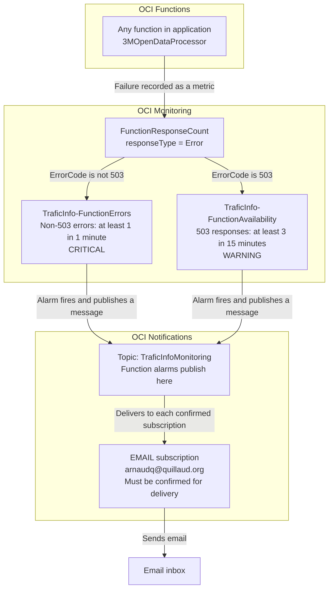

# Monitoring

## TraficInfo metrics

Processing functions publish application metrics through the OCI Monitoring Java
SDK in the `traficinfo` namespace by default. Every metric below has unit `count`
and represents a snapshot, rather than an increment. Retrieval and preprocessing
metrics can be added through the same abstraction.
See the [functions README](../dsfunctions/README.md) for deployment and invocation.
The [Alarms and Notifications](#alarms-and-notifications) chapter describes the
separate function failure alarms based on OCI's built-in metrics.

### `GeoJsonFeatures`

Final number of GeoJSON features published for one datasource and population,
after record filtering, grouping by counter and geometry selection. Each feature
can combine several observation years, so this metric has no year dimension.
Each successful publication emits both populations, including zero for an empty
collection.

| Dimension | Description | Values |
| --- | --- | --- |
| `datasourceId` | Datasource being exported | Bundled source ID, e.g. `DPT34`, `MMM` |
| `population` | Exported counter population | `VEHICULES`, `BICYCLES` |

### `GeoJsonRecordsBeforeFiltering`

Number of annual records loaded from the manifest for one datasource, population
and observation year, before GeoJSON record filters. Population selection occurs
before counting: records classified as neither vehicles nor bicycles are excluded.
This measures annual records, so a counter present in two years contributes once
to each year's count.

| Dimension | Description | Values |
| --- | --- | --- |
| `datasourceId` | Datasource being exported | Bundled source ID, e.g. `DPT34`, `MMM` |
| `population` | Exported counter population | `VEHICULES`, `BICYCLES` |
| `year` | Record's observation year | Year as a string, e.g. `2025`, `2026` |

### `GeoJsonRecordsAfterFiltering`

Number of annual records passing GeoJSON's year, counter/city and traffic-value
filters for one datasource, population and observation year. The rendering window
includes the current year and the preceding ten years; traffic values must be
strictly greater than zero and less than 300,000. Counter and city filters apply
when configured in the renderer. Statistics use the same filtered list as rendering.

This count precedes grouping, geometry selection and history truncation. A record
can pass the filters even when its counter has no geometry and produces no feature.
Use `GeoJsonFeatures` to measure the final rendered output size.

| Dimension | Description | Values |
| --- | --- | --- |
| `datasourceId` | Datasource being exported | Bundled source ID, e.g. `DPT34`, `MMM` |
| `population` | Exported counter population | `VEHICULES`, `BICYCLES` |
| `year` | Record's observation year | Year as a string, e.g. `2025`, `2026` |

### `OSMWayMappings`

Number of counter-to-way mappings in each status for one datasource, after the
hourly OSM refresh. Counts match the log's **all records** status totals, including
mappings not attempted this run. They include uploaded approvals and newly created
review candidates. They do not report only the processed-record subset.

| Dimension | Description | Values |
| --- | --- | --- |
| `datasourceId` | Datasource whose mapping cache was loaded | Source ID from `<datasourceId>_OSMWayMapping.json`, e.g. `MMM` |
| `status` | Mapping assignment outcome | `MISSING`, `MATCHED`, `NEEDS_REVIEW`, `NOT_FOUND` |

| Status | Meaning |
| --- | --- |
| `MISSING` | No usable assignment yet: lookup pending, coordinates unavailable, or an HTTP attempt failed |
| `MATCHED` | A road way is assigned from the seed/manual cache or an accepted reverse lookup |
| `NEEDS_REVIEW` | A candidate requires review because its road reference is missing or differs from the source |
| `NOT_FOUND` | A successful reverse response contained no suitable road way |

### GeoJSON publication

GeoJSON metrics are sent after both output uploads and OSM cache refresh succeed.
For every year represented in either exported population's input records, both
populations emit both record metrics, including zero when a population is absent
or all its records are filtered out. Years outside the rendering window still
have before counts and zero after counts. A completely empty input emits only
the two zero feature counts because there is no record year to attribute.

All observations from a publication share a timestamp and are submitted together
through `MetricsPublisher`. The OCI adapter splits requests at its 50-stream limit.
No previous-run counts or percentage metrics are stored.

### OSM publication

Each successful hourly run emits all four statuses for every loaded datasource,
including zero for empty categories and caches. Sources skipped by the
reverse-lookup time budget are still included. Unchanged mapping/review documents
still produce fresh samples. A run with no mapping caches emits no samples.
All observations from the run share a timestamp.

Metrics are published after a successful refresh and successful review-document
save (including a skipped write when unchanged). A load, refresh or review-save
failure suppresses the run's metrics and retains existing function failure
behavior. Metrics failures are logged without failing the refresh. Publishing
metrics does not change the reverse-lookup budget.

### Querying snapshots

Use the metric's dimensions to select the intended series. `max()` shows the
highest snapshot in each interval; with one publication in that interval, this
is the published count. `sum()` over repeated observations adds snapshots and
should not be used to represent the current count. Intervals without publication
have no data, rather than zero.

```text
GeoJsonFeatures[1h]{datasourceId = "MMM", population = "BICYCLES"}.max()
GeoJsonRecordsBeforeFiltering[1h]{datasourceId = "MMM", population = "BICYCLES", year = "2025"}.max()
GeoJsonRecordsAfterFiltering[1h]{datasourceId = "MMM", population = "BICYCLES", year = "2025"}.max()
OSMWayMappings[1h]{datasourceId = "MMM", status = "NEEDS_REVIEW"}.max()
```

### Configuration and permissions

| Runtime setting | Default |
| --- | --- |
| `METRICS_COMPARTMENT_ID` | Unset: skip metrics with a warning |
| `METRICS_NAMESPACE` | `traficinfo` |

Deployment sets `METRICS_COMPARTMENT_ID` to the shared `OCI_COMPARTMENT_ID` exported
by `scripts/setup.sh` for both GeoJSON and OSM deployment. Each function's
resource-principal dynamic group needs an
additional IAM policy (substitute its name and compartment OCID):

```text
Allow dynamic-group <functions-group> to use metrics in compartment id <compartment-ocid> where target.metrics.namespace='traficinfo'
```

### Publication and failure behavior

The function needs network access to the regional Monitoring ingestion endpoint.
Metrics use resource-principal authentication by default, or the existing local
`arnaudq` OCI profile when `USE_RESOURCE_PRINCIPAL=false`. The client is created
and closed per invocation, with a 2-second connection timeout, 3-second read
timeout, and no request retries. Initialization, transport, partial rejection and
close failures are logged without failing successful data publication. Failed
data/cache publication sends no metrics. No previous counts or percentages are
stored, and this does not create alarms or IAM policies.

### Backend abstraction

`MetricSample` and `MetricsPublisher` define the backend-independent publishing
boundary. New observations can reuse that interface; OCI SDK types and namespace,
compartment, batching and transport details are confined to `OciMetricsPublisher`.
`FunctionMetrics` shares runtime configuration and per-invocation OCI client
lifecycle between GeoJSON and OSM. `GeoJsonPublisher` and `OSMInfoFunction` accept
any `MetricsPublisher` implementation. The four-argument publisher constructor disables metrics for callers
that do not supply a backend.

## Alarms and Notifications

Function failures feed two OCI alarms, which send notifications through a
shared topic to its confirmed email subscriptions. The aim is to identify the
affected function and provide a starting point for investigation.

### Chain of actions



### Components and relationships

| Component | Responsibility |
| --- | --- |
| Application and functions | `3MOpenDataProcessor` contains the functions being monitored. Each invocation contributes its execution metrics. |
| Metric | `FunctionResponseCount` in the `oci_faas` namespace counts responses. Both alarms select responses of type `Error`. `ErrorCode` is the numeric status (such as `503`); `ErrorMessage` is the symbolic cause (such as `FunctionInvokeServiceUnavailable`). |
| Alarms | Separate non-503 failures from repeated 503 availability errors, with different thresholds and severity. |
| Topic | `TraficInfoMonitoring` receives messages from the function alarms and the OSM review alarm and distributes them to its subscriptions. The topic itself contains no error-detection rule. |
| Subscription | Connects a topic to a delivery method and recipient. The EMAIL subscription delivers to `arnaudq@quillaud.org` after confirmation. |

Both alarms cover all functions in the application, including functions added
later. They evaluate each function and error category separately, so one function can
trigger a notification independently of the others. This covers source
retrieval, preprocessing, GeoJSON generation and OSM maintenance when deployed
in that application.

A topic can have several subscriptions. All confirmed subscribers receive the
alarm messages published to it; adding a recipient changes delivery rather than
the alarm condition. Email subscriptions require confirmation before delivery.

### When notifications are sent

| Alarm | Condition per function and error category | Severity |
| --- | --- | --- |
| `TraficInfo-FunctionErrors` | At least one non-503 error in one minute | `CRITICAL` |
| `TraficInfo-FunctionAvailability` | At least three 503 responses in 15 minutes | `WARNING` |

Non-503 failures include application execution errors, timeouts, image-loading
errors and other invocation failures. The availability alarm covers 503 responses
such as `FunctionInvokeServiceUnavailable`, which can occur before application
code runs. Both alarms have a one-minute pending duration; the first breaching
evaluation can move the relevant stream from OK to firing.

The availability threshold reduces noise from transient errors; it is not an
OCI retry limit or proof that retries are exhausted. Resource Scheduler invokes
functions in detached mode, but the reviewed Oracle documentation does not
specify its maximum retry count for 503 responses. Two 503 responses followed
by a successful run do not meet the three-error threshold. Conversely, three
errors can meet it even if a later attempt succeeds within the same window.

An isolated 503 can still mean a missed run, without an email from these alarms.
Checking that a scheduled run eventually succeeded requires separate monitoring.

Email delivery takes several minutes because metrics must be collected and
evaluated before a notification is delivered. Emails show the function name,
alarm state, time, error code and cause, and a link to the alarm, with the function ID available for
investigation. Repeated failures while that function's alarm state
remains firing can be grouped into one incident; this is not one email per failed
invocation. Periodic reminder emails are not configured.

A recovery notification can be sent when the alarm returns to OK. This means
the error condition has cleared; it does not prove that a later invocation
succeeded or that failed processing has been repaired.

### Configuration and operation

`scripts/setup-function-alerts.sh` creates or updates both alarms using
the environment prepared by `scripts/setup.sh`. It checks that the selected
`TraficInfoMonitoring` topic has a confirmed email subscription for the supplied address.
`OCI_FN_ALERT_TOPIC_NAME` selects another existing topic when needed.

The script supports a dry run, checks both definitions before writing, skips
matching settings and verifies applied changes. During migration it creates
availability coverage first, then renames and narrows the legacy
`3MOpenDataProcessor-FunctionErrors` alarm. It does not create topics or
subscriptions. Setup commands are in the
[setup specification](setup.md#function-failure-emails).

After receiving an alert, use the function's resource ID to find its metrics
and invocation logs. Inspect the failed operation and any outputs already
written before retrying. The alert mechanism does not retry functions or roll
back their writes. Confirm recovery through a successful run and the expected
data, rather than relying solely on the alarm returning to OK.

### OSM review reminders

`TraficInfo-OSMWayMappingsNeedReview` is a separate `WARNING` alarm in namespace
`traficinfo`. It evaluates each datasource's review count using:

```text
OSMWayMappings[1h]{status = "NEEDS_REVIEW"}.groupBy(datasourceId).max() > 0
```

Keeping `datasourceId` in the result lets formatted emails identify affected
sources and their counts. **Group notifications across metric streams** combines
qualifying sources into one alarm-level message. The alarm uses a one-minute
pending duration and `repeatNotificationDuration: P1D` for daily reminders while
continuously firing. It sends through the existing `TraficInfoMonitoring` topic
(or `OCI_FN_ALERT_TOPIC_NAME`) and requires a confirmed email subscription.

After `source ./scripts/setup.sh`, preview and apply the definition with:

```sh
./scripts/setup-osm-review-alert.sh arnaudq@quillaud.org --dry-run
./scripts/setup-osm-review-alert.sh arnaudq@quillaud.org
```

The script manages only this alarm, skips a matching definition, reconciles drift
and verifies the result. It rejects duplicate alarms and suppressed or inactive
existing alarms. It does not change function error alarms or create subscriptions.
As with other topic messages, all confirmed email subscribers receive the alert.

The email points to `OSMWayMapping_NEEDS_REVIEW.json` in the OSM bucket. Uploaded
approvals are applied by the next hourly OSM refresh. Counts are maxima within the
last hour, so cleared reviews can remain visible until an older sample leaves
the window. An hourly run that is late or fails can cause a gap and an alarm reset.
Daily repeats are not a strict email cap: recovery, resets and later firing episodes
can produce additional messages. This tradeoff is accepted for the manual review
workflow, where the queue is expected to change slowly.

### OSM ways not found

`TraficInfo-OSMWayMappingsNotFound` adds a separate `WARNING` alarm for successful
reverse lookups that returned no suitable road way. It uses:

```text
OSMWayMappings[1h]{status = "NOT_FOUND"}.groupBy(datasourceId).max() > 0
```

It uses the same confirmed email topic, grouped datasource details, one-minute
pending duration and daily reminders as the review alarm. Configure it explicitly:

```sh
./scripts/setup-osm-review-alert.sh arnaudq@quillaud.org --status NOT_FOUND --dry-run
./scripts/setup-osm-review-alert.sh arnaudq@quillaud.org --status NOT_FOUND
```

Without `--status`, the script continues to manage only `NEEDS_REVIEW`. Each call
reconciles only its selected alarm. The `NOT_FOUND` email points to each affected
`<datasourceId>_OSMWayMapping.json` cache and the stored reverse response; these
records are not included in the dedicated `NEEDS_REVIEW` document.

Daily repeats apply independently to each alarm. If both categories are nonzero,
you can receive one reminder from each alarm per day while continuously firing,
plus any recovery/reset or later firing notifications.

### Coverage and further monitoring

The alarms detect errors recorded by OCI Functions, including runtime failures
such as timeouts. Successful invocations with recoverable warnings do not
trigger it. Functions outside the selected application or region require their
own monitoring setup.

Other monitoring signals answer different questions:

- **Invocation counts:** whether scheduled functions actually ran.
- **Duration and throttling:** whether execution is becoming slow or constrained.
- **Publication metadata and manifests:** whether expected data is available
  and sufficiently recent.

These signals can support future alerts for missed runs, stale data or incomplete
processing. Those alerts are not part of the current function error mechanism.

References: [function error metrics](https://docs.oracle.com/en-us/iaas/Content/Functions/Reference/functionsmetrics.htm),
[scheduled invocation mode](https://docs.oracle.com/en-us/iaas/Content/Functions/Tasks/functionsschedulingfunctions-about.htm),
and [503 troubleshooting](https://docs.oracle.com/en-us/iaas/Content/Functions/Tasks/functionstroubleshooting_topic-Issues-invoking-functions.htm).
