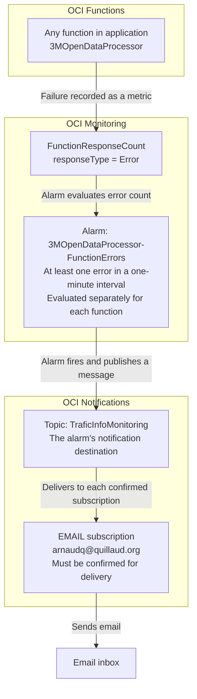

# Monitoring and alerts

Function failures trigger an OCI alarm, which sends a notification through a
shared topic to its confirmed email subscriptions. The aim is to identify the
affected function and provide a starting point for investigation.

## Chain of actions

## Components and relationships

| Component | Responsibility |
| --- | --- |
| Application and functions | `3MOpenDataProcessor` contains the functions being monitored. Each invocation contributes its execution metrics. |
| Metric | `FunctionResponseCount` in the `oci_faas` namespace counts responses. The alarm selects responses of type `Error`. |
| Alarm | `3MOpenDataProcessor-FunctionErrors` evaluates the metric and publishes a notification when its condition is met. |
| Topic | `TraficInfoMonitoring` receives messages from the alarm and distributes them to its subscriptions. The topic itself contains no error-detection rule. |
| Subscription | Connects a topic to a delivery method and recipient. The EMAIL subscription delivers to `arnaudq@quillaud.org` after confirmation. |

One alarm covers all functions in the application, including functions added
later. It evaluates each function separately, so an error in one function can
trigger a notification independently of the others. This covers source
retrieval, preprocessing, GeoJSON generation and OSM maintenance when deployed
in that application.

A topic can have several subscriptions. All confirmed subscribers receive the
alarm messages published to it; adding a recipient changes delivery rather than
the alarm condition. Email subscriptions require confirmation before delivery.

## When notifications are sent

At least one recorded error in a one-minute interval meets the alarm condition.
The alarm has severity `CRITICAL` and a one-minute pending duration. Under that
setting, the first breaching evaluation can move it from OK to firing.

Email delivery takes several minutes because metrics must be collected and
evaluated before a notification is delivered. Emails show the function name,
alarm state, time and a link to the alarm, with the function ID available for
investigation. Repeated failures while that function's alarm state
remains firing can be grouped into one incident; this is not one email per failed
invocation. Periodic reminder emails are not configured.

A recovery notification can be sent when the alarm returns to OK. This means
the error condition has cleared; it does not prove that a later invocation
succeeded or that failed processing has been repaired.

## Configuration and operation

`scripts/setup-function-alerts.sh` creates or updates the dedicated alarm using
the environment prepared by `scripts/setup.sh`. It checks that the selected
`TraficInfoMonitoring` topic has a confirmed email subscription for the supplied address.
`OCI_FN_ALERT_TOPIC_NAME` selects another existing topic when needed.

The script supports a dry run, skips matching settings and verifies applied
changes. It does not create topics or subscriptions. Setup commands are in the
[root README](../README.md#function-failure-emails).

After receiving an alert, use the function's resource ID to find its metrics
and invocation logs. Inspect the failed operation and any outputs already
written before retrying. The alert mechanism does not retry functions or roll
back their writes. Confirm recovery through a successful run and the expected
data, rather than relying solely on the alarm returning to OK.

## Coverage and further monitoring

The alarm detects errors recorded by OCI Functions, including runtime failures
such as timeouts. Successful invocations with recoverable warnings do not
trigger it. Functions outside the selected application or region require their
own monitoring setup.

Other monitoring signals answer different questions:

- **Invocation counts:** whether scheduled functions actually ran.
- **Duration and throttling:** whether execution is becoming slow or constrained.
- **Publication metadata and manifests:** whether expected data is available
  and sufficiently recent.

These signals can support future alerts for missed runs, stale data or incomplete
processing. Those alerts are not part of the current function error mechanism.

