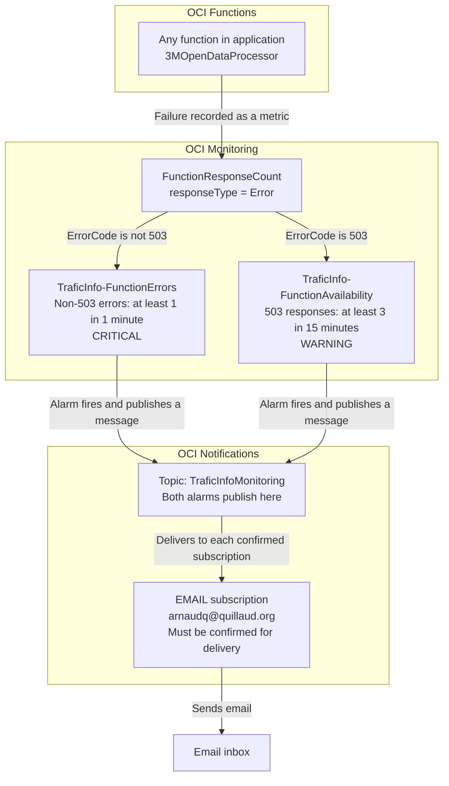

# Monitoring

## TraficInfo metrics

Processing functions use OCI Monitoring for application metrics, published through
its Java SDK. GeoJSON feature counts and records before/after filtering are instrumented;
retrieval and preprocessing metrics can be added through the same abstraction.
See the [functions README](../dsfunctions/README.md#geojson-output) for deployment
and invocation. The [Alarms and Notifications](#alarms-and-notifications) chapter
describes the separate function failure alarms based on OCI's built-in metrics.

### GeoJSON feature counts

After both GeoJSON uploads and OSM cache refresh succeed, the function publishes
`GeoJsonFeatures` through the OCI Monitoring Java SDK. Each invocation includes
two feature-count snapshots, including zero for an empty population:

| Dimension | Values |
| --- | --- |
| `datasourceId` | Bundled source ID, e.g. `DPT34` or `MMM` |
| `population` | `VEHICULES` or `BICYCLES` |

These count the final features after filtering and grouping by counter, not the
annual input records. There is no year dimension because each feature can combine
several years. Use `last()` for the latest observed count within a query interval;
`sum()` would add snapshots from repeated invocations rather than count distinct
features. For example, in namespace `traficinfo`:

```text
GeoJsonFeatures[1h]{datasourceId = "DPT34", population = "VEHICULES"}.last()
```

### GeoJSON record counts

The same publication reports two more snapshot metrics:

| Metric | Meaning |
| --- | --- |
| `GeoJsonRecordsBeforeFiltering` | Annual records loaded from the manifest for the selected population, before GeoJSON record filters |
| `GeoJsonRecordsAfterFiltering` | Annual records passing the year, counter/city and traffic-value filters, before grouping into counter features |

Both have `datasourceId`, `population` (`VEHICULES` or `BICYCLES`) and `year`
(the observation year, e.g. `2024`) dimensions. Units are `count`. For every year
represented in either exported population's input records, both populations emit
both metrics, including zero when a population is absent or all its records are
filtered out. A completely empty input emits only the two zero feature counts,
since there is no record year to attribute. Years outside the rendering window
still have before counts and zero after counts.

The rendering window includes the current year and the preceding ten years;
traffic values must be strictly greater than zero and less than 300,000.
Counter and city filters apply when configured in the renderer. Population
selection precedes the before count, so records classified as neither vehicles
nor bicycles are excluded from both populations.

After-filtering counts measure annual records, including several years for a
single counter. They precede geometry selection and history truncation: a record
can pass these predicates even if its counter cannot produce a feature because
it has no geometry. Use `GeoJsonFeatures` for the final rendered output size.
The statistics are collected from the same filtered list used for rendering,
without rerunning the filters.

```text
GeoJsonRecordsBeforeFiltering[1h]{datasourceId = "DPT34", population = "VEHICULES", year = "2024"}.last()
GeoJsonRecordsAfterFiltering[1h]{datasourceId = "DPT34", population = "VEHICULES", year = "2024"}.last()
```

All observations from a publication share a timestamp and are submitted together
through `MetricsPublisher`. The OCI adapter splits requests at its 50-stream
limit. Record metrics follow the same publication and failure behavior as the
feature counts; they do not add percentage or previous-run metrics.

### Configuration and permissions

| Runtime setting | Default |
| --- | --- |
| `METRICS_COMPARTMENT_ID` | Unset: skip metrics with a warning |
| `METRICS_NAMESPACE` | `traficinfo` |

Deployment sets `METRICS_COMPARTMENT_ID` to the shared `OCI_COMPARTMENT_ID` exported
by `scripts/setup.sh`. The function's resource-principal dynamic group needs an
additional IAM policy (substitute its name and compartment OCID):

```text
Allow dynamic-group <functions-group> to use metrics in compartment id <compartment-ocid> where target.metrics.namespace='traficinfo'
```

### Publication and failure behavior

The function needs network access to the regional Monitoring ingestion endpoint.
Metrics use resource-principal authentication by default, or the existing local
`arnaudq` OCI profile when `USE_RESOURCE_PRINCIPAL=false`. The client is created
and closed per invocation, with a 2-second connection timeout, 3-second read
timeout, and no request retries. Initialization, transport, partial rejection and
close failures are logged without failing successful data publication. Failed
data/cache publication sends no metrics. No previous counts or percentages are
stored, and this does not create alarms or IAM policies.

### Backend abstraction

`MetricSample` and `MetricsPublisher` define the backend-independent publishing
boundary. New observations can reuse that interface; OCI SDK types and namespace,
compartment, batching and transport details are confined to `OciMetricsPublisher`.
`GeoJsonPublisher` accepts any implementation, while `GeoJsonFunction` wires the
OCI adapter. The four-argument publisher constructor disables metrics for callers
that do not supply a backend.

## Alarms and Notifications

Function failures feed two OCI alarms, which send notifications through a
shared topic to its confirmed email subscriptions. The aim is to identify the
affected function and provide a starting point for investigation.

### Chain of actions



### Components and relationships

| Component | Responsibility |
| --- | --- |
| Application and functions | `3MOpenDataProcessor` contains the functions being monitored. Each invocation contributes its execution metrics. |
| Metric | `FunctionResponseCount` in the `oci_faas` namespace counts responses. Both alarms select responses of type `Error`. `ErrorCode` is the numeric status (such as `503`); `ErrorMessage` is the symbolic cause (such as `FunctionInvokeServiceUnavailable`). |
| Alarms | Separate non-503 failures from repeated 503 availability errors, with different thresholds and severity. |
| Topic | `TraficInfoMonitoring` receives messages from both alarms and distributes them to its subscriptions. The topic itself contains no error-detection rule. |
| Subscription | Connects a topic to a delivery method and recipient. The EMAIL subscription delivers to `arnaudq@quillaud.org` after confirmation. |

Both alarms cover all functions in the application, including functions added
later. They evaluate each function and error category separately, so one function can
trigger a notification independently of the others. This covers source
retrieval, preprocessing, GeoJSON generation and OSM maintenance when deployed
in that application.

A topic can have several subscriptions. All confirmed subscribers receive the
alarm messages published to it; adding a recipient changes delivery rather than
the alarm condition. Email subscriptions require confirmation before delivery.

### When notifications are sent

| Alarm | Condition per function and error category | Severity |
| --- | --- | --- |
| `TraficInfo-FunctionErrors` | At least one non-503 error in one minute | `CRITICAL` |
| `TraficInfo-FunctionAvailability` | At least three 503 responses in 15 minutes | `WARNING` |

Non-503 failures include application execution errors, timeouts, image-loading
errors and other invocation failures. The availability alarm covers 503 responses
such as `FunctionInvokeServiceUnavailable`, which can occur before application
code runs. Both alarms have a one-minute pending duration; the first breaching
evaluation can move the relevant stream from OK to firing.

The availability threshold reduces noise from transient errors; it is not an
OCI retry limit or proof that retries are exhausted. Resource Scheduler invokes
functions in detached mode, but the reviewed Oracle documentation does not
specify its maximum retry count for 503 responses. Two 503 responses followed
by a successful run do not meet the three-error threshold. Conversely, three
errors can meet it even if a later attempt succeeds within the same window.

An isolated 503 can still mean a missed run, without an email from these alarms.
Checking that a scheduled run eventually succeeded requires separate monitoring.

Email delivery takes several minutes because metrics must be collected and
evaluated before a notification is delivered. Emails show the function name,
alarm state, time, error code and cause, and a link to the alarm, with the function ID available for
investigation. Repeated failures while that function's alarm state
remains firing can be grouped into one incident; this is not one email per failed
invocation. Periodic reminder emails are not configured.

A recovery notification can be sent when the alarm returns to OK. This means
the error condition has cleared; it does not prove that a later invocation
succeeded or that failed processing has been repaired.

### Configuration and operation

`scripts/setup-function-alerts.sh` creates or updates both alarms using
the environment prepared by `scripts/setup.sh`. It checks that the selected
`TraficInfoMonitoring` topic has a confirmed email subscription for the supplied address.
`OCI_FN_ALERT_TOPIC_NAME` selects another existing topic when needed.

The script supports a dry run, checks both definitions before writing, skips
matching settings and verifies applied changes. During migration it creates
availability coverage first, then renames and narrows the legacy
`3MOpenDataProcessor-FunctionErrors` alarm. It does not create topics or
subscriptions. Setup commands are in the
[root README](../README.md#function-failure-emails).

After receiving an alert, use the function's resource ID to find its metrics
and invocation logs. Inspect the failed operation and any outputs already
written before retrying. The alert mechanism does not retry functions or roll
back their writes. Confirm recovery through a successful run and the expected
data, rather than relying solely on the alarm returning to OK.

### Coverage and further monitoring

The alarms detect errors recorded by OCI Functions, including runtime failures
such as timeouts. Successful invocations with recoverable warnings do not
trigger it. Functions outside the selected application or region require their
own monitoring setup.

Other monitoring signals answer different questions:

- **Invocation counts:** whether scheduled functions actually ran.
- **Duration and throttling:** whether execution is becoming slow or constrained.
- **Publication metadata and manifests:** whether expected data is available
  and sufficiently recent.

These signals can support future alerts for missed runs, stale data or incomplete
processing. Those alerts are not part of the current function error mechanism.

References: [function error metrics](https://docs.oracle.com/en-us/iaas/Content/Functions/Reference/functionsmetrics.htm),
[scheduled invocation mode](https://docs.oracle.com/en-us/iaas/Content/Functions/Tasks/functionsschedulingfunctions-about.htm),
and [503 troubleshooting](https://docs.oracle.com/en-us/iaas/Content/Functions/Tasks/functionstroubleshooting_topic-Issues-invoking-functions.htm).
